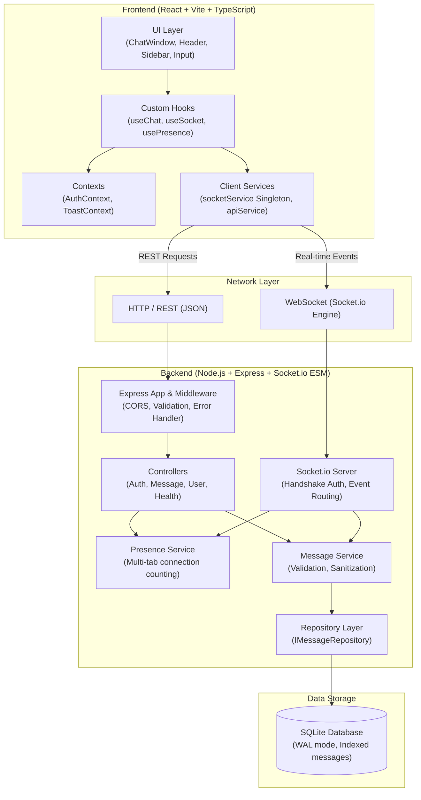

# ChatStream — Real-Time Chat Web Application

A modern, high-performance, real-time web application built with **React**, **Vite**, **TypeScript**, **Tailwind CSS**, **Node.js**, **Express**, **Socket.io**, and **SQLite**.

---

## Architecture Overview



---

## Features

- **Real-Time Messaging**: Instant two-way communication using **Socket.io** WebSockets with fallback to REST.
- **Persistent History**: Chat history is persisted in an indexed SQLite database and loaded upon initial page load or browser reload.
- **Formatted Timestamps & Visual Receipts**: Every message renders with timestamps (e.g. `10:42 AM`) and delivery status ticks (`sent` single tick, `delivered` double tick, `read` sky-blue double tick).
- **Multi-Tab Presence Tracking**: Connection-count tracking per username ensures users remain marked online even when switching between multiple tabs or windows.
- **Live Typing Indicator**: Real-time typing announcements with debounced start/stop broadcasting (`Alice is typing...`).
- **Connection Status Banner**: Dynamic UI banner signaling connection status (`connected`, `connecting`, `disconnected`) with an auto-reconnect engine and manual retry button.
- **XSS Sanitization & Input Validation**: Automatic HTML entity escaping, trimmed content validation, and message length enforcement (max 1000 characters).
- **Centralized Error Handling**: Standardized response envelope `{ success, data, error }` across all REST endpoints and client toast alert notifications.

---

## Tech Stack

| Layer | Technologies |
| :--- | :--- |
| **Frontend** | React 18, Vite, TypeScript, Tailwind CSS, Lucide React Icons |
| **Backend** | Node.js (v22+), Express 4, Socket.io 4, TypeScript (ESM) |
| **Database** | SQLite via native Node `node:sqlite` behind an `IMessageRepository` interface |
| **Testing** | Vitest, Supertest, Playwright (Chromium E2E) |
| **Tooling** | Concurrently, Prettier, TypeScript strict mode |

---

## Repository Structure

```
chat-app/
├── backend/
│   ├── src/
│   │   ├── config/          # Environment configuration and validation
│   │   ├── controllers/     # Express route handlers (Auth, Messages, Users, Health)
│   │   ├── db/              # SQLite connection and schema migration
│   │   ├── middleware/      # Validation & centralized error handler
│   │   ├── repositories/    # IMessageRepository interface & SQLite implementation
│   │   ├── routes/          # Express route definitions
│   │   ├── services/        # MessageService and PresenceService
│   │   ├── sockets/         # Socket.io connection, auth & event pipeline
│   │   ├── utils/           # Response formatter, sanitization, AppError
│   │   ├── app.ts           # Express application setup
│   │   └── index.ts         # Server entrypoint and graceful shutdown
│   ├── tests/               # Vitest endpoint integration tests
│   ├── .env.example
│   ├── Dockerfile           # Multi-stage production container
│   └── package.json
├── frontend/
│   ├── src/
│   │   ├── components/      # ChatWindow, Header, Sidebar, MessageBubble, etc.
│   │   ├── context/         # AuthContext (localStorage), ToastContext
│   │   ├── hooks/           # useChat, useSocket, usePresence
│   │   ├── pages/           # LoginPage, ChatPage
│   │   ├── services/        # socket.service (singleton), api.service
│   │   ├── types/           # Shared TypeScript interfaces
│   │   ├── utils/           # Timestamp formatting, avatar colors
│   │   ├── App.tsx
│   │   └── main.tsx
│   ├── .env.example
│   ├── index.html
│   ├── tailwind.config.js
│   ├── vite.config.ts
│   └── package.json
├── docs/
│   ├── SCREEN_RECORDING_GUIDE.md
│   └── screenshots/         # Automated Playwright test captures
├── scripts/
│   ├── verify-rest.sh       # Curl verification script
│   ├── verify-sockets.mjs   # Standalone two-client Socket.io verification
│   └── e2e-playwright.mjs   # Headless browser multi-user E2E test
├── render.yaml              # Render deployment blueprint
├── PLAN.md
├── FINAL_REPORT.md
└── package.json             # Root monorepo scripts
```

---

## Getting Started

### Prerequisites
- **Node.js**: v22.0.0 or later (Node 22+ contains built-in native SQLite `DatabaseSync`)
- **npm**: v10.0.0 or later

### Installation

Clone the repository and install dependencies at the root and workspaces:

```bash
# Clone the repository
git clone <repo-url>
cd chat-app

# Install root dependencies
npm install

# Install backend dependencies
cd backend && npm install && cd ..

# Install frontend dependencies
cd frontend && npm install && cd ..
```

---

## Running the Application

### 1. Unified Development Server (Backend + Frontend)
Run both backend (`http://localhost:4000`) and frontend (`http://localhost:5173`) concurrently from the root directory:

```bash
npm run dev
```

### 2. Running Backend Independently
```bash
cd backend
npm run dev      # Runs with tsx watcher
# or
npm run build && npm start
```

### 3. Running Frontend Independently
```bash
cd frontend
npm run dev      # Runs Vite dev server on port 5173
# or
npm run build && npm run preview
```

---

## Environment Variables

### Backend (`backend/.env`)

| Variable | Default | Description | Example |
| :--- | :--- | :--- | :--- |
| `PORT` | `4000` | Port for Express & Socket.io server | `PORT=4000` |
| `CLIENT_ORIGIN`| `http://localhost:5173` | Allowed CORS origin (or `*`) | `CLIENT_ORIGIN=http://localhost:5173` |
| `DB_PATH` | `./data/chat.db` | File path to SQLite database file | `DB_PATH=./data/chat.db` |
| `NODE_ENV` | `development` | Runtime environment (`development`, `production`, `test`) | `NODE_ENV=development` |

### Frontend (`frontend/.env`)

| Variable | Default | Description | Example |
| :--- | :--- | :--- | :--- |
| `VITE_API_URL` | `http://localhost:4000` | Base URL for REST API and Socket.io server | `VITE_API_URL=http://localhost:4000` |

---

## REST API Documentation

All responses conform to the standardized shape:
```json
{
  "success": true,
  "data": { ... },
  "error": null
}
```

### 1. Health Check
`GET /health` or `GET /api/health`
- **Response** (200 OK):
  ```json
  {
    "success": true,
    "data": {
      "status": "ok",
      "uptime": 12.4,
      "timestamp": "2026-09-28T08:56:28.846Z"
    },
    "error": null
  }
  ```

### 2. User Login
`POST /api/login`
- **Request Body**:
  ```json
  {
    "username": "alice"
  }
  ```
- **Response** (200 OK):
  ```json
  {
    "success": true,
    "data": {
      "username": "alice",
      "message": "Login successful"
    },
    "error": null
  }
  ```

### 3. Send Message
`POST /api/messages`
- **Request Body**:
  ```json
  {
    "username": "alice",
    "text": "Hello, world!"
  }
  ```
- **Response** (201 Created):
  ```json
  {
    "success": true,
    "data": {
      "id": "5ba52c96-ad28-4f83-83ee-dd172b9d5313",
      "username": "alice",
      "text": "Hello, world!",
      "status": "sent",
      "createdAt": "2026-09-28T08:52:21.801Z"
    },
    "error": null
  }
  ```

### 4. Get Message History (Paginated)
`GET /api/messages?limit=50&before=2026-09-28T08:52:21.801Z`
- **Query Parameters**:
  - `limit` (optional, default: 50, max: 100): Number of messages to return.
  - `before` (optional): ISO timestamp cursor to fetch older history.
- **Response** (200 OK):
  ```json
  {
    "success": true,
    "data": [
      {
        "id": "1c7b80a1-9a7f-4422-9a3b-287711d51a24",
        "username": "bob",
        "text": "Hey Alice!",
        "status": "read",
        "createdAt": "2026-09-28T08:50:10.000Z"
      },
      {
        "id": "5ba52c96-ad28-4f83-83ee-dd172b9d5313",
        "username": "alice",
        "text": "Hello, world!",
        "status": "read",
        "createdAt": "2026-09-28T08:52:21.801Z"
      }
    ],
    "error": null
  }
  ```
  *(Returned sorted oldest to newest for direct display in chat feed)*.

### 5. Get Online Users
`GET /api/users/online`
- **Response** (200 OK):
  ```json
  {
    "success": true,
    "data": {
      "users": ["alice", "bob"],
      "count": 2
    },
    "error": null
  }
  ```

---

## Socket.io Event Reference

### Handshake Authentication
When connecting, clients provide their username via handshake `auth` or `query`:
```typescript
io('http://localhost:4000', {
  auth: { username: 'alice' }
});
```

### Events Table

| Event | Direction | Payload | Description |
| :--- | :--- | :--- | :--- |
| `message:new` | Client -> Server | `{ text: string, id?: string }` | Sends a new chat message |
| `message:new` | Server -> All | `Message` object | Broadcasts newly persisted message |
| `typing:start` | Client -> Server | *(none)* | Informs server that user started typing |
| `typing:start` | Server -> Others | `{ username: string }` | Broadcasts typing state to other clients |
| `typing:stop` | Client -> Server | *(none)* | Informs server that user stopped typing |
| `typing:stop` | Server -> Others | `{ username: string }` | Broadcasts typing ended to other clients |
| `presence:update` | Server -> All | `{ users: string[], count: number }` | Emitted when any user connects/disconnects |
| `message:delivered`| Client -> Server | `{ messageId?: string, messageIds?: string[] }` | Recipient confirms message delivery |
| `message:delivered`| Server -> All | `{ ids: string[], status: 'delivered' }` | Updates message status to delivered |
| `message:read` | Client -> Server | `{ messageId?: string, messageIds?: string[] }` | Recipient confirms message was viewed |
| `message:read` | Server -> All | `{ ids: string[], status: 'read' }` | Updates message status to read |
| `error` | Server -> Client | `{ message: string }` | Notifies client of validation or processing error |

---

## Testing & Verification

### 1. REST Endpoint Unit & Integration Tests (Vitest)
```bash
npm run test
```
Runs 11 automated test cases verifying `/health`, `/api/login`, `/api/messages` validation, XSS sanitization, message persistence, pagination, and `/api/users/online`.

### 2. Standalone REST Curl Verification
```bash
bash scripts/verify-rest.sh
```

### 3. Standalone Two-Client Socket.io Verification
```bash
node scripts/verify-sockets.mjs
```
Launches two independent Socket.io client instances, verifying presence broadcast, bidirectional typing indicators, real-time message exchange, delivered/read receipts, and disconnect presence cleanup.

### 4. Headless Browser End-to-End Test (Playwright)
```bash
node scripts/e2e-playwright.mjs
```
Automates two browser contexts (Alice and Bob), verifies real-time typing indicators, message sending, status receipt updates, page reload persistence from SQLite, and saves screenshot artifacts in `docs/screenshots/`.

---

## Design Decisions & Assumptions

### Assumptions
1. **Database Driver**: The project specification prioritizes `better-sqlite3`, falling back to `node:sqlite` or `sqlite3` if native installation fails. On Node.js v26 on macOS, `better-sqlite3` native compilation fails due to C++ standard library header differences. As explicitly specified, the project falls back to Node.js's built-in `node:sqlite` (`DatabaseSync`), requiring zero external native compilation while offering high-performance synchronous SQLite operations in WAL mode.
2. **Repository Abstraction**: All database interactions are encapsulated behind `IMessageRepository`. Swapping SQLite for MongoDB or PostgreSQL requires only writing a new class implementing `IMessageRepository` without touching controllers or socket handlers.
3. **Multi-Tab Presence**: Single users opening multiple tabs or windows are tracked by a `Map<username, Set<socketId>>`. The user is counted once in the online count and only removed from presence when all their open connections disconnect.
4. **Idempotent Delivery Receipts**: Receipts support both single message IDs and bulk arrays (`{ messageId }` or `{ messageIds }`) to minimize socket traffic on initial load.
5. **Disk Persistence on Cloud Hosts**: On cloud free tiers (e.g. Render Free Tier), local disk storage is ephemeral across deploys. Persistent disks or hosted databases (e.g. MongoDB Atlas) are documented below for production state retention.

---

## Known Limitations & Production Recommendations

1. **Render Free Tier Ephemeral Storage**:
   - Render's free tier spins down on inactivity and does not include persistent disk attachments. SQLite files in the container will be reset when the container restarts.
   - **Production Recommendation**: Mount a persistent disk (see `render.yaml`) on Render's Paid Tier, or swap the `IMessageRepository` implementation for MongoDB Atlas or AWS RDS PostgreSQL.
2. **Single-Node Socket.io Scaling**:
   - In-memory presence and Socket.io broadcasts run on a single Node instance.
   - **Scaling Recommendation**: For multi-instance clustered deployments, attach `@socket.io/redis-adapter` so events and presence sync across all backend replicas.

---

## Deployment Guide

### Deploying Backend on Render

1. Create a new **Web Service** on [Render](https://render.com).
2. Connect your GitHub repository.
3. Set the following configuration:
   - **Root Directory**: `backend`
   - **Environment**: `Node`
   - **Build Command**: `npm install && npm run build`
   - **Start Command**: `npm start`
4. Configure Environment Variables:
   - `NODE_ENV`: `production`
   - `PORT`: `10000`
   - `CLIENT_ORIGIN`: `https://your-frontend.vercel.app` (or `*`)
   - `DB_PATH`: `/var/data/chat.db`
5. *(Optional)* Add a Persistent Disk mounted at `/var/data` with 1GB size.

*Alternatively, deploy automatically using the included blueprint:*
- Use the root [render.yaml](file:///Users/devpatel/Projects/chat-app/render.yaml) blueprint via Render's **Blueprints** tab.

### Deploying Backend on Railway

1. Connect your repository to [Railway](https://railway.app).
2. Select the `backend` folder as root directory.
3. Railway will automatically detect the `Dockerfile` or `package.json`.
4. Add environment variables (`PORT`, `CLIENT_ORIGIN`).
5. Add a persistent volume for `/app/data` to retain SQLite messages across deploys.

### Deploying Frontend on Vercel / Netlify

1. Connect the repository to [Vercel](https://vercel.com) or [Netlify](https://netlify.com).
2. Set configuration:
   - **Framework Preset**: `Vite`
   - **Root Directory**: `frontend`
   - **Build Command**: `npm run build`
   - **Output Directory**: `dist`
3. Add Environment Variable:
   - `VITE_API_URL`: `https://your-backend.onrender.com`
4. Deploy!
